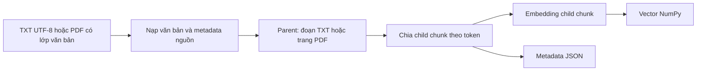
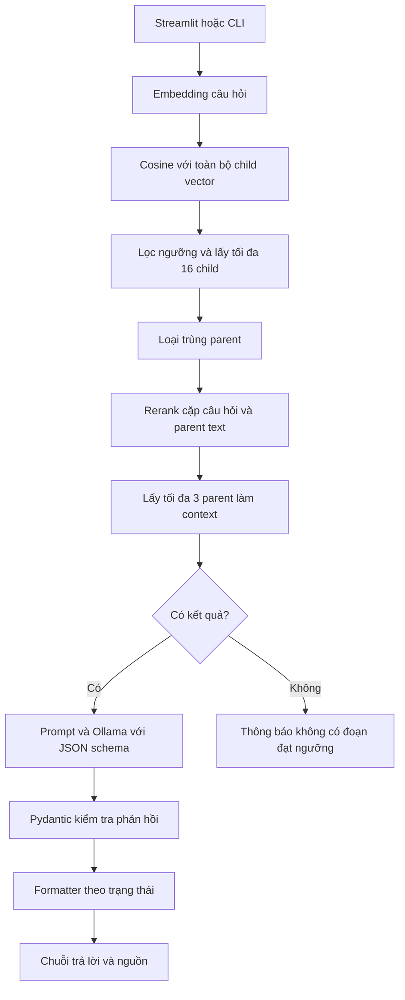

# Vietnamese Policy RAG

Ứng dụng RAG hỏi đáp tiếng Việt trên tài liệu TXT và PDF có lớp văn bản, kết hợp tìm kiếm ngữ nghĩa, reranking và Qwen3 4B chạy local qua Ollama. Người dùng có thể **nạp PDF trực tiếp trên Streamlit**, hỏi về tài liệu vừa nạp và đối chiếu câu trả lời với nội dung nguồn cùng số trang.

Dự án được xây dựng để học cách triển khai một ứng dụng AI từ xử lý tài liệu đến API, giao diện và đánh giá kết quả. Các bước chunking, tính cosine similarity, chọn kết quả và xây dựng context được viết thành các module Python riêng để dễ kiểm tra luồng xử lý.

## Bài toán và dữ liệu

Tài liệu chính là [store_policy_demo.txt](store_policy_demo.txt), mô tả chính sách giao hàng, đổi sản phẩm, hoàn tiền và bảo hành của một cửa hàng giả lập. Cửa hàng, địa chỉ và thông tin liên hệ trong tài liệu đều là dữ liệu thực hành.

[sample.pdf](sample.pdf) là tài liệu thực hành **13 trang có lớp văn bản**, được biên soạn từ chính sách TXT của dự án. Trang đầu là phần giới thiệu và mục lục; 12 trang sau trình bày từng mục chính sách, kèm diễn giải và tình huống minh họa. Cửa hàng, địa chỉ, email và tình huống đều là giả lập.

PDF này dùng để kiểm tra truy xuất nội dung ở các trang khác nhau, trả lời theo nguồn và giữ số trang qua API đến giao diện. Bộ đánh giá gồm **5 ca phát triển** và ghi nhận **5/5 ca đạt** trên môi trường phát triển. [Bộ câu hỏi](pdf_evaluation_cases.py) · [Báo cáo môi trường phát triển](pdf_evaluation_report.json)

Ví dụ câu hỏi:

- Sản phẩm được bảo hành bao lâu?
- Điều kiện để được đổi sản phẩm trong 14 ngày là gì?
- Sản phẩm không bị lỗi nhưng tôi muốn đổi sang mẫu khác thì có được không?
- Phí vận chuyển khi gửi sản phẩm đi bảo hành là bao nhiêu?

Câu hỏi cuối dùng để kiểm tra việc từ chối trả lời khi thiếu căn cứ. Model đề xuất trạng thái trả lời và các ID nguồn dưới dạng JSON; Python kiểm tra cấu trúc rồi định dạng câu trả lời. Schema không tự xác minh được model đã chọn đúng trạng thái hay bằng chứng hay chưa.

## Chức năng hiện có

- Đọc TXT UTF-8 hoặc trích xuất văn bản từ PDF bằng pypdf, chuẩn hóa đầu ra thành các record có nội dung và metadata nguồn.
- Nạp PDF qua Streamlit hoặc `POST /upload`; tạo index trong RAM và chuyển các câu hỏi tiếp theo sang tài liệu mới.
- Dùng mỗi đoạn TXT hoặc mỗi trang PDF có văn bản làm parent, sau đó chia thành các child chunk theo token.
- Tạo embedding cho child chunk; các script build lưu metadata vào JSON và vector vào NumPy `.npy`.
- Truy xuất bằng cosine similarity, lọc theo ngưỡng và chọn các ứng viên có điểm cao nhất.
- Loại các ứng viên trùng parent, rerank theo nội dung đầy đủ của parent rồi dùng nội dung đó làm context.
- Yêu cầu Ollama sinh JSON theo schema Pydantic, gồm `status`, `answer` và `cited_chunk_ids`.
- Dùng formatter để ghép nhãn `[chunk_ID]` khi model báo có căn cứ; trả câu thông báo cố định không kèm trích dẫn khi model báo thiếu thông tin.
- Giữ số trang PDF trong metadata, context, nguồn trả về của API và nhãn hộp nguồn trên Streamlit.
- Cung cấp FastAPI backend, Streamlit UI và chế độ hỏi đáp trên terminal.
- Chọn index TXT hoặc PDF được nạp lúc khởi động bằng `INDEX_DIR` trong `config.py`; API có thể thay index đang dùng bằng PDF upload.
- Lưu kết quả đánh giá vào JSON; kiểm tra cụm đáp án mong đợi và ID trích dẫn ngoài context.
- Chạy bộ kiểm tra PDF qua API với nhóm cách diễn đạt được chấp nhận, đối chiếu nguồn/trang hoặc yêu cầu không có trích dẫn; ghi báo cáo JSON cùng lỗi từng ca.

## Luồng xử lý

### Chuẩn bị index



Record mới lưu `chunk_id`, `text`, `parent_id`, `parent_text`, `source` và `page_number`. Với TXT, `page_number` là `None`; với PDF, số trang bắt đầu từ 1 và giữ theo vị trí trong tài liệu gốc, kể cả khi bỏ qua trang không có văn bản. Index TXT cũ thiếu trường này vẫn được đọc nhờ cách lấy metadata bằng `.get()`.

| Index mẫu | Nguồn | Số parent | Số child chunk | Kích thước mảng vector |
| --- | --- | --- | --- | --- |
| `index/` | `store_policy_demo.txt` | 14 | 37 | `37 × 384` |
| `index_pdf/` | `sample.pdf` | 13 | 84 | `84 × 384` |

### Nạp PDF khi API đang chạy

UI gửi file bằng multipart/form-data tới `POST /upload`. API đọc từng trang, bỏ qua trang không có văn bản rồi dùng chung phần chia chunk và tạo embedding với các script build. Chỉ sau khi xử lý thành công, kết quả mới được gán vào `app.state.knowledge`.

Upload thay **toàn bộ index đang dùng trong RAM của tiến trình API**. Ứng dụng chưa lưu PDF hoặc index upload để sử dụng lại; index đang hoạt động chỉ được giữ trong RAM. Mọi client dùng cùng tiến trình API chia sẻ index này; khi khởi động lại, API nạp lại thư mục `INDEX_DIR` thay vì khôi phục PDF upload.

### Trả lời câu hỏi



Chunk nhỏ giúp tìm vị trí liên quan. Parent cung cấp thêm các điều kiện xung quanh để câu trả lời có đủ căn cứ. Reranker chấm cặp `[query, parent_text]`; context cuối cùng cũng chứa `parent_text`.

`chunk_id` trong trích dẫn là ID của child được chọn làm điểm tham chiếu. Vì vậy, nội dung nguồn hiển thị có thể dài hơn child chunk ban đầu. `retrieved_sources` chứa toàn bộ nguồn được đưa vào context, kể cả nguồn không được câu trả lời trích dẫn.

Với PDF, context và nguồn API có thêm số trang. Nhãn `[chunk_ID]` vẫn là ID của child, không phải số trang. Với cấu hình hiện tại, mỗi câu hỏi dùng tối đa 3 parent; khi đọc PDF, đó là tối đa 3 trang được chọn.

### Đầu ra có cấu trúc và định dạng câu trả lời

[answer_schema.py](answer_schema.py) khai báo lớp `LLMAnswer`. Client truyền `LLMAnswer.model_json_schema()` vào trường `format` của Ollama, đọc `message.content` bằng `model_validate_json()` và chuyển kết quả thành dictionary. [answer_formatter.py](answer_formatter.py) tạo chuỗi trả lời cuối cùng. Xem [tài liệu structured outputs của Ollama](https://docs.ollama.com/capabilities/structured-outputs).

Ví dụ đầu ra nội bộ cho một thông tin phủ định được nguồn nói rõ:

```json
{
  "status": "supported",
  "answer": "Tài liệu không công bố số điện thoại hỗ trợ.",
  "cited_chunk_ids": [84]
}
```

Formatter ghép thành `Tài liệu không công bố số điện thoại hỗ trợ. [chunk_84]`. Thông tin “không được công bố” có thể là câu trả lời có căn cứ, không mặc định là thiếu context.

Ví dụ đầu ra nội bộ khi chưa đủ căn cứ:

```json
{
  "status": "insufficient_context",
  "answer": "",
  "cited_chunk_ids": []
}
```

Với trạng thái này, formatter luôn trả câu cố định bên dưới, bỏ qua nội dung và ID model đề xuất:

> Các đoạn được cung cấp chưa đủ thông tin để trả lời câu hỏi này.

Đây là hai trạng thái nội bộ; `POST /ask` vẫn trả `answer` dưới dạng chuỗi. Nếu retrieval không tìm được đoạn đạt ngưỡng, pipeline không gọi Ollama và trả `Không có đoạn nào đạt ngưỡng tìm kiếm.`

Pydantic kiểm tra các trường bắt buộc, kiểu dữ liệu và hai giá trị trạng thái. Nó chưa kiểm tra model phân loại đúng hay không, ID có thuộc context không, hoặc nội dung nguồn có hỗ trợ phát biểu không. Với `supported`, formatter giữ nội dung model trả về và ghép các ID được đề xuất; đây chưa phải cơ chế kiểm chứng ngữ nghĩa.

## Công nghệ và cấu hình

| Thành phần | Công nghệ / giá trị |
| --- | --- |
| Embedding | [paraphrase-multilingual-MiniLM-L12-v2](https://huggingface.co/sentence-transformers/paraphrase-multilingual-MiniLM-L12-v2), chạy qua FastEmbed |
| Reranker | [mmarco-mMiniLMv2-L12-H384-v1](https://huggingface.co/cross-encoder/mmarco-mMiniLMv2-L12-H384-v1), dùng CrossEncoder trên CPU |
| Sinh câu trả lời | [Qwen3 4B](https://ollama.com/library/qwen3:4b) qua Ollama `/api/chat`, không streaming |
| Cấu hình sinh | `temperature = 0`, `seed = 42` trong `llm_client.py` |
| Đầu ra model | JSON schema từ Pydantic; kiểm tra trước khi định dạng |
| Chunking tại script build và API upload | 64 token/chunk, overlap 16 token; chưa tính special tokens |
| Truy xuất | `RETRIEVAL_K = 16`, `RETRIEVAL_MIN_SCORE = 0.3` |
| Sau reranking | `RERANK_TOP_N = 3` |
| Đọc PDF | [pypdf](https://pypdf.readthedocs.io/en/stable/user/extract-text.html) |
| Backend / UI | FastAPI / Streamlit; `python-multipart` để nhận file upload |
| Lưu index | JSON metadata và NumPy `float32` array |

Các tham số truy xuất và lựa chọn index nằm trong [config.py](config.py). Tên model và tham số chunking hiện vẫn được khai báo trong các script tương ứng.

Cấu hình sinh cố định giúp so sánh các lượt thử rõ hơn, không bảo đảm câu trả lời luôn đúng hoặc giống hệt trên mọi môi trường. Server hiện in trạng thái và ID model chọn ra terminal để hỗ trợ quan sát khi thử nghiệm. Xem [tham số Ollama](https://docs.ollama.com/modelfile#valid-parameters-and-values).

`RETRIEVAL_K` là số **child chunk trước khi loại trùng parent**, không phải số đoạn parent. Điểm của reranker có thể âm và không cùng thang đo với cosine similarity; ngưỡng `0.3` chỉ dùng ở bước truy xuất ban đầu.

### Chọn index để hỏi đáp

Cấu hình hiện tại trong `config.py` chọn PDF:

```python
INDEX_DIR = "index_pdf"
```

| Giá trị `INDEX_DIR` | Index được API và CLI đọc | `/health` với dữ liệu mẫu |
| --- | --- | --- |
| `"index"` | Chính sách TXT trong `index/` | `chunk_count: 37` |
| `"index_pdf"` | PDF 13 trang trong `index_pdf/` | `chunk_count: 84` |

Đổi giá trị rồi **khởi động lại API hoặc CLI** để nạp index mới. Với API, đây là index ban đầu; upload thành công sẽ thay nó trong RAM. `/health` báo số chunk của index đang hoạt động, nên sau upload số này có thể khác bảng trên.

CLI tự nạp index trên đĩa và không gọi API. Upload qua Streamlit không thay đổi index của CLI.

`INDEX_DIR` điều khiển index được đọc khi hỏi đáp. Hai script build bên dưới có nguồn và thư mục lưu riêng; chúng không đổi đích lưu theo biến này.

## Cài đặt trên Windows PowerShell

Môi trường đã chạy dự án: **Windows, Python 3.12.10**. Thực hiện các lệnh trong thư mục chứa README này. Các lệnh dùng trực tiếp Python của `.venv`, nên không cần kích hoạt môi trường bằng `Activate.ps1`.

Để tải code từ GitHub:

```powershell
git clone https://github.com/dangthanh204bn/vietnamese-policy-rag.git
cd vietnamese-policy-rag
```

### 1. Tạo môi trường Python

Nếu đã có `.venv` hoạt động, có thể bỏ qua bước tạo môi trường.

```powershell
python -m venv .venv
.\.venv\Scripts\python.exe -m pip install --upgrade pip
```

### 2. Cài thư viện

Reranker hiện chạy trên CPU. Cài PyTorch CPU, sau đó cài các thư viện ứng dụng:

```powershell
.\.venv\Scripts\python.exe -m pip install torch --index-url https://download.pytorch.org/whl/cpu
.\.venv\Scripts\python.exe -m pip install -r requirements.txt
```

Tham khảo [hướng dẫn cài PyTorch](https://pytorch.org/get-started/locally/) và [các lệnh cài bản CPU](https://pytorch.org/get-started/previous-versions/).

Các thư viện ứng dụng, gồm `pypdf==6.21.4` và `python-multipart==0.0.32`, được cố định phiên bản trong [requirements.txt](requirements.txt). `python-multipart` phục vụ endpoint nhận file. PyTorch CPU được cài riêng theo lệnh phía trên và hiện chưa cố định phiên bản.

Phiên bản ghi nhận trên môi trường phát triển:

| Thư viện | Phiên bản |
| --- | --- |
| fastembed | 0.9.0 |
| tokenizers | 0.23.3 |
| numpy | 2.5.4 |
| requests | 2.34.2 |
| torch | 2.14.1+cpu |
| sentence-transformers | 6.2.0 |
| fastapi | 0.162.0 |
| pydantic | 2.14.1 |
| uvicorn | 0.54.0 |
| streamlit | 1.66.1 |
| pypdf | 6.21.4 |
| python-multipart | 0.0.32 |

Đây là thông tin môi trường đã sử dụng; `requirements.txt` chưa khóa toàn bộ phụ thuộc bắc cầu hoặc phiên bản PyTorch. Kết quả thử cài mới bản TXT được ghi riêng ở phần kiểm tra bên dưới.

### 3. Chuẩn bị Ollama

Cài [Ollama cho Windows](https://docs.ollama.com/windows), mở ứng dụng Ollama và tải model:

```powershell
ollama --version
ollama pull qwen3:4b
ollama list
```

Nếu Ollama chưa chạy nền, có thể khởi động trong một terminal riêng:

```powershell
ollama serve
```

Chỉ cần một Ollama server đang chạy. Endpoint ứng dụng sử dụng là `http://localhost:11434/api/chat` trong [llm_client.py](llm_client.py).

Chạy model local theo cách này không cần API key trả phí. Lần đầu sử dụng vẫn cần kết nối mạng để tải model Ollama, embedding, tokenizer và reranker. Xem thêm [hướng dẫn Ollama](https://docs.ollama.com/quickstart).

### 4. Tạo index TXT

```powershell
.\.venv\Scripts\python.exe -X utf8 build_index.py
```

Script đọc `store_policy_demo.txt`, tạo embedding và lưu:

```text
index/
├── chunk_records.json
└── chunk_vectors.npy
```

Với dữ liệu hiện tại, log sẽ báo 37 chunk và 37 vector. Khi sửa tài liệu, cách chunking hoặc embedding model, cần **build lại index rồi khởi động lại API**. Index hiện chưa tự phát hiện thay đổi của dữ liệu hay model.

### 5. Tạo index PDF

```powershell
.\.venv\Scripts\python.exe -X utf8 pdf_index_demo.py
```

Script đọc `sample.pdf` và lưu:

```text
index_pdf/
├── chunk_records.json
└── chunk_vectors.npy
```

Với PDF mẫu hiện tại, kết quả là **84 chunk và 84 vector**, mỗi vector có 384 chiều. Có 13 parent, tương ứng với 13 trang có văn bản. API và CLI đang chọn index này qua `INDEX_DIR = "index_pdf"` trong `config.py`.

Sau khi tạo lại index, khởi động lại API hoặc CLI để nạp dữ liệu mới. Để hỏi trên TXT, đổi thành `INDEX_DIR = "index"` rồi khởi động lại.

Để lưu index của tài liệu khác xuống đĩa, sửa biến `file_path` trong script build tương ứng rồi tạo lại index. Để thử nhanh một PDF khi API đang chạy, dùng chức năng upload trên Streamlit. PDF đầu vào cần có lớp văn bản để trích xuất; dự án chưa thực hiện OCR cho trang chỉ chứa ảnh scan.

## Chạy ứng dụng

Đảm bảo Ollama đang chạy. Mở hai terminal trong thư mục dự án và giữ cả hai tiến trình hoạt động.

**Terminal 1 — FastAPI:**

```powershell
.\.venv\Scripts\python.exe -X utf8 -m uvicorn api_server:app --app-dir . --host 127.0.0.1 --port 8000
```

Backend tải index, embedding model, reranker và tokenizer một lần khi tiến trình server khởi động. Cần có index hợp lệ trong `INDEX_DIR` trước khi khởi động, kể cả khi định dùng upload. Mỗi câu hỏi vẫn cần tạo embedding cho query, truy xuất, rerank và gọi Ollama nếu có context.

Lệnh trên không bật tự nạp lại code. Khi sửa code, prompt hoặc cấu hình, dừng API bằng `Ctrl+C` rồi chạy lại và đợi `Application startup complete`. Sau khi khởi động lại, cần nạp lại PDF upload nếu muốn tiếp tục dùng nó.

**Terminal 2 — Streamlit:**

```powershell
.\.venv\Scripts\python.exe -X utf8 -m streamlit run ui.py --server.address 127.0.0.1 --server.port 8501
```

- Giao diện: [http://localhost:8501](http://localhost:8501).
- Swagger UI để thử API: [http://127.0.0.1:8000/docs](http://127.0.0.1:8000/docs).
- Kiểm tra backend: [http://127.0.0.1:8000/health](http://127.0.0.1:8000/health).

Trên giao diện:

1. Có thể hỏi ngay trên index API đã nạp lúc khởi động.
2. Để dùng một PDF khác, chọn file ở **Chọn tài liệu PDF**, rồi bấm **Nạp tài liệu**. Chỉ chọn file chưa gửi yêu cầu tạo index.
3. Khi upload thành công, UI hiển thị tên file, kích thước byte và số chunk, đồng thời xóa câu trả lời trước đó.
4. Nhập câu hỏi, bấm **Gửi câu hỏi** và mở các hộp nguồn để đối chiếu nội dung, tên file và số trang.

UI giữ phản hồi gần nhất trong session; các câu hỏi được xử lý độc lập, chưa có lịch sử hội thoại đưa vào model. Các hộp nguồn là những đoạn đã truy xuất, có thể vẫn hiện khi câu trả lời từ chối hoặc không trích dẫn chúng.

Nếu Streamlit hỏi `Email:` ở lần chạy đầu, có thể nhấn Enter để bỏ qua. Tham khảo [cách chạy Streamlit](https://docs.streamlit.io/get-started/installation/command-line).

Có thể dùng CLI thay cho API và UI:

```powershell
.\.venv\Scripts\python.exe -X utf8 app.py
```

CLI cũng đọc index được chọn bởi `INDEX_DIR`. Phần nguồn ở CLI hiện in tên file, chunk ID và nội dung parent; nhãn số trang riêng được hiển thị trên Streamlit và trong nguồn API.

Nhập `exit` để thoát CLI. Dùng `Ctrl+C` trong terminal tương ứng để dừng API hoặc Streamlit. Chạy các lệnh từ đúng thư mục dự án, nhất là khi có nhiều bản clone trên máy.

## API

### `GET /health`

Với `INDEX_DIR = "index"` và tài liệu TXT mẫu:

```json
{
  "status": "ok",
  "chunk_count": 37
}
```

Với cấu hình hiện tại `INDEX_DIR = "index_pdf"` và PDF 13 trang:

```json
{
  "status": "ok",
  "chunk_count": 84
}
```

Endpoint này báo số chunk của index đang hoạt động, gồm cả index vừa upload. Hai ví dụ trên chỉ áp dụng cho index mẫu tương ứng. Health check chưa kiểm tra khả năng kết nối hoặc sinh câu trả lời của Ollama.

### `POST /upload`

Nhận PDF qua multipart/form-data với trường **`file`**. Có thể dùng Swagger UI: chọn `POST /upload` → **Try it out** → chọn file → **Execute**.

Ví dụ response với `sample.pdf`:

```json
{
  "filename": "sample.pdf",
  "content_type": "application/pdf",
  "page_count": 13,
  "text_page_count": 13,
  "chunk_count": 84
}
```

`page_count` là tổng số trang vật lý; `text_page_count` chỉ đếm trang có văn bản trích xuất được. Tên nguồn trong metadata lấy từ tên file upload. Với tài liệu khác, các số đếm sẽ thay đổi.

| HTTP status | Trường hợp |
| --- | --- |
| `200` | Đọc PDF, tạo chunk/vector thành công và thay index trong RAM |
| `400` | Bắt được `PdfReadError`, hoặc không có văn bản để xử lý |
| `422` | Request không hợp lệ, ví dụ thiếu trường `file` |

Nếu đọc hoặc tạo index thất bại, bước gán index mới chưa thực hiện nên index đang dùng được giữ lại. Lỗi build/embedding chưa có ánh xạ HTTP riêng. Ứng dụng chưa lưu PDF và index upload để khôi phục cho lần chạy sau. Upload không đổi `INDEX_DIR` và không có index riêng cho từng phiên người dùng.

### `POST /ask`

Ví dụ request khi chọn index TXT (`INDEX_DIR = "index"`):

```json
{
  "query": "Sản phẩm được bảo hành bao lâu?"
}
```

Ví dụ response, đã rút ngắn nội dung và danh sách nguồn để minh họa cấu trúc:

```json
{
  "received_query": "Sản phẩm được bảo hành bao lâu?",
  "answer": "Sản phẩm được bảo hành trong 18 tháng kể từ ngày giao hàng thành công được ghi nhận trên đơn. [chunk_23]",
  "retrieved_sources": [
    {
      "chunk_id": 23,
      "source": "store_policy_demo.txt",
      "text": "8. THỜI HẠN VÀ PHẠM VI BẢO HÀNH\nSản phẩm được bảo hành trong 18 tháng kể từ ngày giao hàng thành công được ghi nhận trên đơn...",
      "page_number": null
    }
  ]
}
```

Response thực tế trả đầy đủ `parent_text` cho từng nguồn được chọn. Câu trả lời có thể thay đổi giữa các lần sinh.

### Ví dụ hỏi trên PDF

Sau khi tạo index PDF và khởi động API với `INDEX_DIR = "index_pdf"`, gửi:

```json
{
  "query": "Khoản hoàn tiền được xử lý trong bao lâu và tính từ mốc nào?"
}
```

Phản hồi đã ghi nhận trong lần chạy thử, rút ngắn nội dung nguồn và chỉ giữ nguồn được trích dẫn để minh họa:

```json
{
  "received_query": "Khoản hoàn tiền được xử lý trong bao lâu và tính từ mốc nào?",
  "answer": "Khoản hoàn tiền được xử lý trong 5 ngày làm việc kể từ ngày phương án hoàn tiền được chấp thuận. [chunk_51]",
  "retrieved_sources": [
    {
      "chunk_id": 51,
      "source": "sample.pdf",
      "text": "...Khoản hoàn tiền được xử lý trong 5 ngày làm việc kể từ ngày phương án hoàn tiền được chấp thuận. Tiền được hoàn về phương thức thanh toán ban đầu...",
      "page_number": 8
    }
  ]
}
```

Phản hồi đầy đủ trong [pdf_evaluation_result.json](pdf_evaluation_result.json) có ba nguồn; câu trả lời sử dụng `[chunk_51]` ở trang 8. Trên Streamlit, hộp nguồn này có nhãn `[chunk_51] sample.pdf | Trang: 8`.

Nguồn TXT trả `page_number: null` và không thêm số trang vào nhãn. API dùng `.get()` nên vẫn xử lý được index TXT cũ thiếu trường này. ID child có thể thay đổi nếu thay tài liệu hoặc cách chia chunk; cần đối chiếu ID và trang trong index của lần chạy tương ứng.

### Mã trạng thái của `/ask`

| HTTP status | Trường hợp |
| --- | --- |
| `200` | Xử lý thành công, bao gồm cả phản hồi không đủ thông tin hoặc không có đoạn đạt ngưỡng |
| `400` | `query` rỗng hoặc chỉ chứa khoảng trắng |
| `422` | Request không hợp lệ theo schema, ví dụ thiếu trường `query` |
| `502` | Nội dung model trả về không vượt qua kiểm tra JSON/schema của Pydantic (`ValidationError`) |
| `503` | Không kết nối được Ollama khi cần gọi sinh câu trả lời |
| `504` | Quá thời gian chờ phản hồi Ollama |

Nếu chính FastAPI đã dừng, UI nhận lỗi kết nối HTTP, không nhận được response `503` từ backend. Nhánh `502` chỉ xử lý `ValidationError`; các lỗi upstream HTTP, cấu trúc envelope hoặc lỗi chương trình khác chưa được ánh xạ đầy đủ.

## Kiểm tra cài đặt và chạy thử

### Cài mới bản TXT

Trước khi bổ sung PDF, bản TXT đã được thử bằng một `.venv` mới từ bản clone GitHub trên cùng máy:

- Windows, Python 3.12.10, PyTorch `2.15.0+cpu`.
- `pip check` không phát hiện dependency bị lỗi; các module chính import được.
- Tạo lại index được 37 chunk và 37 vector, mỗi vector 384 chiều.
- FastAPI `/health` trả về 37 chunk.
- Đã thử thủ công Streamlit → API → Ollama với câu có thông tin và câu thiếu thông tin.

Lượt kiểm tra này chỉ áp dụng cho bản TXT. Môi trường Python được tạo mới trên cùng máy, dùng lại Ollama và model đã tải.

### Chạy thử PDF 13 trang

- Đọc được văn bản trên cả 13 trang của `sample.pdf` và giữ đúng số trang vật lý.
- Index đã lưu có 13 parent, 84 child chunk và mảng vector `float32` kích thước `84 × 384`.
- API đã được chạy với index PDF; `/health` trả về 84 chunk.
- Bốn phản hồi API thực tế được lưu thủ công trong [pdf_evaluation_result.json](pdf_evaluation_result.json), gồm câu hỏi, câu trả lời và toàn bộ nguồn đã đưa vào context.
- Cả 12 bản ghi nguồn trong file kết quả khớp với index về tên file, số trang và nội dung parent; các ID được trích dẫn đều thuộc context của câu tương ứng.
- Việc truyền metadata qua context, API và nhãn UI cũng đã được kiểm tra với dữ liệu PDF, TXT có số trang `None` và bản ghi TXT cũ thiếu trường trang.

| Câu hỏi | Nội dung trả lời đã đối chiếu thủ công | Trích dẫn | Trang |
| --- | --- | --- | --- |
| Khoản hoàn tiền được xử lý trong bao lâu và tính từ mốc nào? | 5 ngày làm việc kể từ ngày phương án hoàn tiền được chấp thuận | `[chunk_51]` | 8 |
| Đơn nội thành xác nhận đúng 15 giờ bắt đầu tính thời gian giao từ ngày nào? | Ngày làm việc kế tiếp, theo quy định từ 15 giờ trở đi | `[chunk_17]` | 3 |
| Địa chỉ email hỗ trợ của cửa hàng là gì? | `hotro@cuahangmau.example` | `[chunk_80]` | 13 |
| Số điện thoại hỗ trợ của cửa hàng là gì? | Tài liệu không công bố số điện thoại hỗ trợ | `[chunk_84]` | 13 |

Bốn phản hồi này đã được đọc đối chiếu thủ công với nội dung nguồn và số trang. Ở câu hỏi số điện thoại, mô hình nêu thông tin không được công bố trong tài liệu.

`pdf_evaluation_result.json` là snapshot lưu thủ công từ các lần hỏi ban đầu, không phải báo cáo chấm điểm. Bộ đánh giá tự động hiện dùng bốn câu hỏi đó và thêm một ca thiếu thông tin về phí gửi đi bảo hành; kết quả được ghi vào báo cáo riêng.

Một lượt thử PDF trước đó dùng bản clone GitHub và `.venv` có sẵn. Sau khi cập nhật code và cài thêm phụ thuộc, lượt thử tạo lại 84 chunk và 84 vector, khởi động API rồi hỏi qua Streamlit về hoàn tiền và số điện thoại.

Luồng Streamlit → upload PDF → tạo index trong RAM → hỏi đáp đã được thử trên môi trường phát triển với bản sao của `sample.pdf` mang tên khác. Nguồn trả về đổi theo tên file upload. Ca thiếu thông tin cho cùng câu từ chối và trạng thái `insufficient_context` trong ba lượt hỏi liên tiếp.

### Kiểm tra bản clone với môi trường Python mới

Bản clone ở commit `22f40c9` được thử trên cùng máy với `.venv` mới, Python `3.12.10` và PyTorch `2.15.0+cpu`, dùng lại Ollama và model đã tải. `pip check` đạt, tạo lại được 84 chunk và 84 vector từ `sample.pdf`. Sau khi nạp PDF qua Streamlit, câu hỏi về thời hạn hoàn tiền trả đúng nội dung và dẫn nguồn đến trang 8.

Lượt đánh giá tự động đạt **4/5** và cả năm request đều thành công. Ca hỏi về phí gửi sản phẩm đi bảo hành trượt vì câu trả lời gắn `[chunk_23]` về phí giao hàng. Bộ chấm kỳ vọng câu từ chối cố định và danh sách trích dẫn rỗng. [Báo cáo bản clone](pdf_evaluation_report_clean_clone.json)

Lượt thử thủ công bổ sung đạt **4/4** trên bốn câu khác. Hai câu có căn cứ trích đúng trang 7 và 11. Hai câu thiếu thông tin được phân loại là `insufficient_context` với danh sách ID rỗng.

## Đánh giá PDF qua API

Bộ năm câu hỏi nằm trong [pdf_evaluation_cases.py](pdf_evaluation_cases.py). Mỗi ca có `query` và `expected_fact_groups`. Bốn ca cần nguồn khai báo thêm `expected_source`, `expected_page`; ca từ chối khai báo `expect_citations: False` và không yêu cầu hai trường nguồn/trang.

Trước khi chạy, bảo đảm API đang dùng đúng `sample.pdf` 13 trang của dự án, với cách chunking hiện tại. Có thể khởi động lại API với `INDEX_DIR = "index_pdf"` và index mẫu đã build, hoặc nạp lại chính `sample.pdf` qua UI. Nếu trước đó đã upload PDF khác, evaluator sẽ dùng index upload đang hoạt động; nó không tự phục hồi dữ liệu mẫu.

Bốn ca đối chiếu tên file chính xác là `sample.pdf`. Một bản sao có tên khác dù cùng nội dung vẫn có thể trượt phần kiểm tra nguồn. `/health` báo 84 chunk chưa đủ xác nhận đúng tên file. Giữ Ollama và FastAPI hoạt động, mở terminal khác trong thư mục dự án và chạy:

```powershell
.\.venv\Scripts\python.exe -X utf8 pdf_evaluation.py
```

[pdf_evaluation.py](pdf_evaluation.py) lần lượt gửi từng câu hỏi tới `POST http://127.0.0.1:8000/ask` và kiểm tra phản hồi của backend đang chạy. Script dùng index đã được API nạp; việc chọn index và tạo embedding tài liệu được thực hiện ở các bước chuẩn bị trước đó.

### Nhóm cụm từ mong đợi

`expected_fact_groups` là danh sách các nhóm; mỗi nhóm chứa một hoặc nhiều cụm diễn đạt cùng một ý. Quy tắc là **OR trong nhóm, AND giữa các nhóm**: một nhóm khớp khi có ít nhất một phương án xuất hiện, và câu trả lời phải khớp tất cả các nhóm bắt buộc.

Ví dụ, câu hoàn tiền cần đủ thời hạn và mốc bắt đầu:

```python
expected_fact_groups = [
    ["5 ngày làm việc"],
    ["ngày phương án hoàn tiền được chấp thuận"]
]
```

Câu số điện thoại chấp nhận hai cách diễn đạt của cùng một ý:

```python
expected_fact_groups = [
    ["không được công bố", "không công bố"]
]
```

Cách chấm này được bổ sung sau khi câu trả lời đúng về nghĩa “Tài liệu không công bố số điện thoại...” từng bị chấm trượt vì cụm cố định là “không được công bố”. Các phương án được khai báo trong bộ câu hỏi và được chuyển thành chữ thường, gộp khoảng trắng trước khi so khớp với câu trả lời.

### Điều kiện chấm từng ca

`expect_citations` mặc định là `True` khi không được khai báo:

- Với `True`, câu trả lời phải trích ít nhất một nguồn khớp đồng thời tên file và trang mong đợi.
- Với `False`, câu trả lời phải không có bất kỳ nhãn `[chunk_ID]` nào được parser nhận dạng. Một ID có tồn tại trong context vẫn làm ca này trượt.

Ca thứ năm dùng cấu trúc:

```python
{
    "query": "Phí vận chuyển khi gửi sản phẩm đi bảo hành là bao nhiêu?",
    "expected_fact_groups": [
        ["Các đoạn được cung cấp chưa đủ thông tin để trả lời câu hỏi này."]
    ],
    "expect_citations": False
}
```

Câu số điện thoại vẫn cần trích dẫn vì nguồn nói rõ thông tin không được công bố. Câu phí gửi đi bảo hành kiểm tra việc từ chối khi các đoạn được cung cấp không có căn cứ trả lời.

| Trường trong báo cáo | Cách kiểm tra |
| --- | --- |
| `missing_facts` | Các nhóm trong `expected_fact_groups` chưa khớp phương án nào; mỗi phần tử là cả một nhóm, nên kết quả có dạng danh sách lồng nhau |
| `invalid_ids` | Các ID dạng `[chunk_ID]` được trích nhưng không thuộc `retrieved_sources` của câu đó |
| `source_match` | Với ca cần trích dẫn: có ít nhất một nguồn **được câu trả lời trích dẫn**, khớp tên file và số trang trên cùng bản ghi. Là `null` ở ca `expect_citations=False` vì phép kiểm tra này không áp dụng |
| `citation_check_passed` | Kết quả kiểm tra trích dẫn theo loại ca: đúng nguồn/trang khi cần nguồn, hoặc không có nhãn khi ca yêu cầu từ chối không trích dẫn |
| `passed` | Với ca chấm được phản hồi: `missing_facts` rỗng, `invalid_ids` rỗng và `citation_check_passed` là `True`; ca gặp lỗi request là `False` |
| `error` | `null` khi ca đã xử lý được phản hồi; chuỗi mô tả ngoại lệ khi bắt được `requests.exceptions.RequestException` |

Ở ca cần nguồn, trang mong đợi chỉ xuất hiện trong context chưa đủ để đạt `source_match`; câu trả lời phải trích ID của nguồn đó. Không có trích dẫn sẽ làm ca này trượt. Với ca từ chối đúng yêu cầu, `source_match: null` đi cùng `citation_check_passed: true` và `passed: true` là kết quả hợp lệ.

`missing_facts: []` nghĩa là mọi nhóm thông tin bắt buộc đã khớp. Nếu câu hoàn tiền chỉ nêu thời hạn, kết quả thiếu là `[["ngày phương án hoàn tiền được chấp thuận"]]`.

### Xử lý lỗi từng ca

Mỗi lượt gọi và chấm được đặt trong `try/except`. Nếu bắt được `requests.exceptions.RequestException`, như lỗi kết nối, timeout, HTTP hoặc lỗi giải mã JSON của Requests, script thêm bản ghi lỗi rồi tiếp tục câu hỏi kế tiếp.

Trong bản ghi lỗi, `answer` là `null`, `retrieved_sources` là `[]`, `passed` là `false` và `error` chứa chuỗi mô tả ngoại lệ. Các trường `missing_facts`, `invalid_ids`, `source_match` và `citation_check_passed` là `null`, biểu thị các phép kiểm tra chưa được thực hiện. Với ca xử lý được phản hồi, `error` là `null`; ca đó vẫn có thể trượt điều kiện chấm.

### Báo cáo và kết quả đã ghi nhận

Sau khi duyệt xong các ca, script ghi một lần bằng UTF-8 vào [pdf_evaluation_report.json](pdf_evaluation_report.json), đặt cạnh script. Mỗi bản ghi lưu `query`, `answer`, toàn bộ `retrieved_sources`, `missing_facts`, `invalid_ids`, `source_match`, `citation_check_passed`, `passed` và `error`. Với ca chấm được phản hồi, tập ID không hợp lệ được chuyển thành danh sách trước khi ghi JSON.

| Nội dung kiểm tra | [Mốc trước khi cố định tham số sinh](pdf_evaluation_report_before_sampling.json) | [Báo cáo môi trường phát triển](pdf_evaluation_report.json) |
| --- | --- | --- |
| Tổng số ca | 5 | 5 |
| Ca đạt điều kiện bộ chấm | 4/5 | **5/5** |
| Ca có lỗi request được ghi nhận | 0/5 | 0/5 |
| Ca thiếu nhóm thông tin mong đợi | 1/5 | 0/5 |
| Ca có ID trích dẫn ngoài context | 0/5 | 0/5 |
| Ca cần nguồn trích đúng tên file và trang | 4/4 | 4/4 |
| Ca từ chối đúng câu mong đợi và không có nhãn | 0/1 | 1/1 |

Trong báo cáo 5/5 trên môi trường phát triển, bốn ca cần nguồn trích `[chunk_51]` ở trang 8 cho hoàn tiền, `[chunk_17]` ở trang 3 cho mốc xác nhận đúng 15 giờ, `[chunk_80]` ở trang 13 cho email và `[chunk_84]` ở trang 13 cho thông tin số điện thoại không được công bố.

Ở mốc 4/5 trước khi cố định tham số sinh, câu phí gửi đi bảo hành nhận `Tài liệu không quy định phí giao hàng [chunk_23]`. ID này có trong context nhưng đoạn chỉ nói về giao hàng, không đủ căn cứ cho phí gửi đi bảo hành. Bộ chấm đánh trượt vì câu không khớp cách từ chối mong đợi và vẫn có nhãn trích dẫn. Trong báo cáo 5/5 trên môi trường phát triển, câu này là `Các đoạn được cung cấp chưa đủ thông tin để trả lời câu hỏi này.`, không kèm nhãn.

Code hiện tại khai báo `temperature=0`, `seed=42`. Hai báo cáo là các snapshot ghi nhận trong quá trình phát triển, chưa chứa timestamp, phiên bản model, cấu hình sinh hay prompt của từng lượt. So sánh này không chứng minh riêng thay đổi tham số sinh sẽ luôn cải thiện kết quả.

Mỗi lần duyệt xong bộ câu hỏi sẽ **ghi đè báo cáo tự động** bằng kết quả mới, kể cả khi mọi ca đều gặp `RequestException`. Ngoại lệ khác, như `KeyError` hoặc `TypeError`, vẫn có thể dừng chương trình; nếu lỗi xảy ra trước bước ghi file, báo cáo cũ vẫn còn. Cần xác nhận lần chạy đã hoàn thành khi đọc kết quả. `evaluation_report.py` vẫn đọc kết quả TXT; báo cáo PDF được tạo trực tiếp bởi `pdf_evaluation.py`.

Đây là **năm ca phát triển trên một PDF giả lập**, đã được dùng để điều chỉnh prompt, bộ chấm và cấu hình. `5/5` không phải “độ chính xác 100%” trên câu hỏi mới. `passed` phản ánh việc khớp cụm từ và quy tắc trích dẫn được khai báo. Cách diễn đạt chưa có trong nhóm vẫn có thể bị chấm trượt; việc khớp chuỗi cũng chưa xác nhận đầy đủ ý nghĩa. Phép kiểm tra nguồn xác nhận ID, tên file và trang, chưa tự đánh giá từng phát biểu có được nội dung nguồn hỗ trợ hay không.

## Đánh giá trên bộ TXT

Bộ câu hỏi nằm trong [policy_evaluation_cases.py](policy_evaluation_cases.py). Bật Ollama rồi chạy:

```powershell
.\.venv\Scripts\python.exe -X utf8 policy_evaluation.py
.\.venv\Scripts\python.exe -X utf8 evaluation_report.py
```

Evaluator hiện **đọc TXT và tạo lại embedding trong bộ nhớ**, sau đó gọi trực tiếp pipeline. Nó không dùng index đã lưu, không chọn nguồn theo `INDEX_DIR` và không gửi request qua FastAPI hoặc Streamlit. Lệnh đầu ghi đè file kết quả tương ứng với cấu hình và số ca hiện tại.

Snapshot TXT từ giai đoạn trước: [evaluation_policy_rerank_k16_n8.json](evaluation_policy_rerank_k16_n8.json), cấu hình `k=16`, `min_score=0.3`, `top_n=3`. Các kết quả bên dưới mô tả snapshot này, không phải kết quả PDF hoặc một lần chạy lại TXT sau khi bổ sung upload và structured output.

`evaluation_report.py` hiện đọc cố định file `evaluation_policy_rerank_k16_n8.json`. Khi đổi `k` hoặc số ca đánh giá, cần cập nhật đường dẫn đầu vào của report để đọc đúng file kết quả mới.

| Nội dung kiểm tra | Kết quả |
| --- | --- |
| Tổng số câu hỏi | 8 |
| Câu có thông tin trả lời trong tài liệu | 6 |
| Câu có chứa cụm đáp án mong đợi, không phân biệt hoa/thường | 6/6 |
| Câu thiếu thông tin | 2 |
| Câu thiếu thông tin được đọc và xác nhận từ chối phù hợp | 2/2, kiểm tra thủ công |
| Câu có ID trích dẫn ngoài context đã chọn | 0/8 |

Đây là bộ câu hỏi nhỏ dùng trong quá trình phát triển và điều chỉnh hệ thống, chưa phải bộ test độc lập. So khớp chuỗi không đánh giá đầy đủ ý nghĩa, tính đầy đủ hay độ chính xác của toàn bộ câu trả lời. ID trích dẫn nằm trong context cũng chưa chứng minh nội dung được trích dẫn hỗ trợ đúng phát biểu. Các con số trên không phải độ chính xác tổng quát của ứng dụng.

### Quan sát khi điều chỉnh retrieval

Với câu hỏi **“Điều kiện để đổi sản phẩm trong 14 ngày là gì?”**, thử nghiệm `k=12` từng bỏ sót mục 5 — phần chứa điều kiện chấp thuận đổi. Tăng `top_n` ở reranker không khôi phục được phần đã bị loại ở bước lấy ứng viên. Khi tăng `k` lên 16, một child của mục 5 được đưa vào và parent của nó xuất hiện trong context cuối.

Thử nghiệm này cho thấy cần kiểm tra cả danh sách ứng viên trước reranking. Giá trị `k=16` là lựa chọn hiện tại trên dữ liệu thực hành, chưa được chứng minh tối ưu cho tài liệu hay cách diễn đạt khác.

## Tài liệu dài

Pipeline có thể lập index nhiều chunk và chọn phần liên quan để trả lời câu hỏi. Toàn bộ tài liệu được dùng khi tạo index; mỗi lần hỏi chỉ chọn một phần nội dung làm context. Dự án đã chạy thử PDF có lớp văn bản gồm **13 trang, 84 child chunk**, với bộ năm ca phát triển kiểm tra qua API. Chưa đo giới hạn số trang, hiệu năng trên dữ liệu lớn hoặc chất lượng trên tài liệu dài và bố cục phức tạp hơn.

Các điểm cần kiểm tra khi mở rộng dữ liệu:

- Parent PDF hiện là toàn trang. Reranker đang dùng khai báo giới hạn 512 token đầu vào cho cặp câu hỏi và nội dung; chuỗi quá dài sẽ bị cắt. Vì vậy, tìm được child liên quan chưa bảo đảm reranker đọc được toàn bộ trang chứa child đó. Xem [cấu hình tokenizer của model](https://huggingface.co/cross-encoder/mmarco-mMiniLMv2-L12-H384-v1/blob/main/tokenizer_config.json) và [tài liệu CrossEncoder](https://www.sbert.net/docs/package_reference/cross_encoder/model.html).
- Context builder nối các parent được chọn, nhưng client chưa tính ngân sách token của toàn prompt. Dữ liệu đưa vào mô hình cần phù hợp với [cửa sổ ngữ cảnh được cấu hình trong Ollama](https://docs.ollama.com/context-length).
- Mỗi câu hỏi hiện chọn tối đa 3 parent. Câu hỏi cần tổng hợp nhiều trang có thể thiếu căn cứ; chưa có pipeline riêng để tóm tắt toàn bộ tài liệu dài.
- Truy xuất quét tuyến tính mọi child vector và giữ index trong RAM. Chưa đo thời gian xử lý hoặc mức sử dụng bộ nhớ khi số chunk tăng lớn.

## Các file chính

| File | Vai trò |
| --- | --- |
| [build_index.py](build_index.py) | Tạo index TXT trong `index/` |
| [pdf_index_demo.py](pdf_index_demo.py) | Tạo và lưu index PDF mẫu trong `index_pdf/` |
| [document_loader.py](document_loader.py) | Chọn loader theo đuôi file và chuẩn hóa cấu trúc đầu ra |
| [load_documents.py](load_documents.py), [pdf_loader.py](pdf_loader.py) | Đọc TXT; dùng chung hàm trích xuất trang PDF cho file trên đĩa và file upload |
| [chunking.py](chunking.py) | Chia văn bản thành các chunk theo token |
| [knowledge_base.py](knowledge_base.py), [index_store.py](index_store.py) | Tạo records/vector từ đường dẫn hoặc danh sách trang; lưu và nạp index trên đĩa |
| [retrieval.py](retrieval.py), [semantic_retrieval.py](semantic_retrieval.py) | Tính cosine và chọn child chunk |
| [reranking.py](reranking.py) | Chấm lại và sắp xếp các parent ứng viên |
| [context_builder.py](context_builder.py), [prompt_builder.py](prompt_builder.py) | Ghép nguồn và xây prompt |
| [llm_client.py](llm_client.py) | Gửi schema và cấu hình sinh tới Ollama, kiểm tra nội dung JSON, ghi trạng thái/ID ra terminal |
| [answer_schema.py](answer_schema.py), [answer_formatter.py](answer_formatter.py) | Định nghĩa cấu trúc phản hồi model và định dạng chuỗi trả lời theo trạng thái |
| [rag_pipeline.py](rag_pipeline.py) | Điều phối các bước hỏi đáp |
| [config.py](config.py) | Chọn index, tham số truy xuất và số kết quả rerank |
| [api_server.py](api_server.py), [ui.py](ui.py), [app.py](app.py) | Backend nhận upload/hỏi đáp, giao diện web và CLI độc lập |
| [policy_evaluation.py](policy_evaluation.py), [evaluation.py](evaluation.py), [evaluation_report.py](evaluation_report.py) | Chạy đánh giá, lấy ID trích dẫn và tổng hợp kết quả |
| [pdf_evaluation_result.json](pdf_evaluation_result.json) | Lưu thủ công bốn phản hồi API trên PDF 13 trang, kèm nội dung nguồn và số trang |
| [pdf_evaluation_cases.py](pdf_evaluation_cases.py) | Khai báo năm ca PDF, nhóm cách diễn đạt và yêu cầu có/không có trích dẫn |
| [pdf_evaluation.py](pdf_evaluation.py) | Gọi API, chấm nhóm thông tin và trích dẫn, ghi lỗi từng ca và báo cáo JSON |
| [pdf_evaluation_report.json](pdf_evaluation_report.json) | Báo cáo 5/5 trên môi trường phát triển, gồm phản hồi, kiểm tra trích dẫn và lỗi request |
| [pdf_evaluation_report_before_sampling.json](pdf_evaluation_report_before_sampling.json) | Mốc 4/5 lưu trước khi cố định tham số sinh để đối chiếu |
| [pdf_evaluation_report_clean_clone.json](pdf_evaluation_report_clean_clone.json) | Báo cáo 4/5 từ bản clone với môi trường Python mới |

Các file như `embedding_demo.py`, `tokenizer_demo.py`, `rerank_demo.py` và `knowledge.txt` lưu những bài thực hành trước đó. [pdf_demo.py](pdf_demo.py) là bài thử trích xuất văn bản PDF; việc tạo index PDF được thực hiện bằng `pdf_index_demo.py`.

## Giới hạn hiện tại

- Mỗi script build có một đường dẫn tài liệu khai báo trong code. API hỗ trợ upload một PDF để thay index trong RAM; chưa lưu index upload, gom nhiều tài liệu hoặc tách dữ liệu theo phiên/người dùng. CLI dùng index trên đĩa riêng.
- PDF hiện hỗ trợ trích xuất lớp văn bản. Chưa có OCR cho trang chỉ chứa ảnh; bố cục nhiều cột và bảng biểu chưa được đánh giá. Xem [giới hạn trích xuất văn bản của pypdf](https://pypdf.readthedocs.io/en/stable/user/extract-text.html).
- Retrieval quét tuyến tính toàn bộ vector bằng cosine; index JSON/NumPy chưa có tìm kiếm ANN hay vector database.
- Chưa tự phát hiện index cũ; cần tự đảm bảo embedding model khi hỏi khớp với model đã dùng để build.
- Chưa đo độ trễ, tải đồng thời hoặc chất lượng trên bộ câu hỏi độc lập lớn hơn.
- Schema kiểm tra cấu trúc phản hồi, không chứng minh câu trả lời đúng. Formatter kiểm soát nhánh `insufficient_context`, nhưng model vẫn có thể chọn `supported` sai. API chưa tự đối chiếu ID với context hoặc kiểm chứng trích dẫn có hỗ trợ từng phát biểu.
- Phiên bản hiện tại phục vụ chạy local; chưa có xác thực người dùng, đóng gói triển khai hoặc streaming.

## Hướng phát triển

- Khóa đầy đủ dependency, phiên bản PyTorch và ghi nhận phiên bản model; thử cài mới lại bản có hỗ trợ PDF.
- Bổ sung lưu trữ file/index upload và cơ chế chọn tài liệu rõ ràng; tách index theo tài liệu hoặc người dùng khi mở rộng.
- Mở rộng bộ đánh giá với câu diễn đạt lại, câu cần nhiều mục và câu thiếu thông tin; tách bộ phát triển và bộ test.
- Mở rộng bộ PDF sang tài liệu dài hơn, câu hỏi cần nhiều trang và các cách diễn đạt khác.
- Bổ sung thời điểm chạy, cấu hình, phiên bản model và phân loại lỗi vào báo cáo đánh giá.
- Giới hạn kích thước parent và tổng token context để xử lý tài liệu dài phù hợp với từng mô hình.
- Đo chất lượng retrieval, độ đầy đủ của câu trả lời và thời gian xử lý để so sánh cấu hình.
- Thêm thông tin phiên bản index để phát hiện thay đổi tài liệu hoặc embedding model trước khi hỏi đáp.
