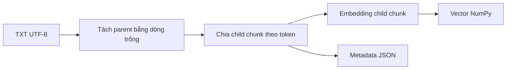
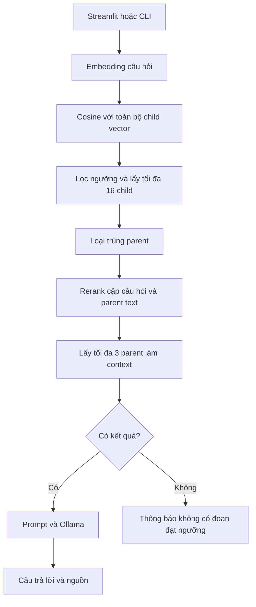

# Vietnamese Policy RAG

Ứng dụng hỏi đáp tài liệu tiếng Việt, kết hợp tìm kiếm ngữ nghĩa, reranking và mô hình ngôn ngữ chạy qua Ollama. Người dùng nhập câu hỏi trên Streamlit, nhận câu trả lời kèm nhãn trích dẫn và mở các đoạn tài liệu đã được đưa vào ngữ cảnh.

Dự án được xây dựng để học cách triển khai một ứng dụng AI từ xử lý tài liệu đến API, giao diện và đánh giá kết quả. Các bước chunking, tính cosine similarity, chọn kết quả và xây dựng context được viết thành các module Python riêng để dễ kiểm tra luồng xử lý.

## Bài toán và dữ liệu

Tài liệu chính là [store_policy_demo.txt](store_policy_demo.txt), mô tả chính sách giao hàng, đổi sản phẩm, hoàn tiền và bảo hành của một cửa hàng giả lập. Cửa hàng, địa chỉ và thông tin liên hệ trong tài liệu đều là dữ liệu thực hành.

Ví dụ câu hỏi:

- Sản phẩm được bảo hành bao lâu?
- Điều kiện để được đổi sản phẩm trong 14 ngày là gì?
- Sản phẩm không bị lỗi nhưng tôi muốn đổi sang mẫu khác thì có được không?
- Phí vận chuyển khi gửi sản phẩm đi bảo hành là bao nhiêu?

Câu hỏi cuối dùng để kiểm tra cách hệ thống phản hồi khi tài liệu thiếu thông tin. Prompt yêu cầu mô hình trả lời theo tài liệu, trích dẫn nguồn và nêu rõ khi không đủ thông tin.

## Chức năng hiện có

- Đọc TXT UTF-8 và chia tài liệu thành các đoạn gốc (parent), sau đó chia thành các chunk nhỏ theo token (child).
- Tạo embedding cho child chunk; lưu metadata vào JSON và vector vào NumPy `.npy`.
- Truy xuất bằng cosine similarity, lọc theo ngưỡng và chọn các ứng viên có điểm cao nhất.
- Loại các ứng viên trùng parent, rerank theo nội dung đầy đủ của parent rồi dùng nội dung đó làm context.
- Sinh câu trả lời tiếng Việt qua Ollama với nhãn nguồn dạng `[chunk_23]`.
- Cung cấp FastAPI backend, Streamlit UI và chế độ hỏi đáp trên terminal.
- Lưu kết quả đánh giá vào JSON; kiểm tra cụm đáp án mong đợi và ID trích dẫn ngoài context.

## Luồng xử lý

### Chuẩn bị index



Mỗi record lưu `chunk_id`, `text`, `parent_id`, `parent_text` và `source`. Với tài liệu hiện tại, index có **37 child chunk**, thuộc **14 đoạn parent**; mỗi embedding có **384 chiều**.

### Trả lời câu hỏi



**Vì sao tìm trên chunk nhỏ nhưng trả về đoạn gốc?** Chunk nhỏ giúp tìm vị trí liên quan. Đoạn gốc cung cấp thêm các điều kiện xung quanh, tránh chỉ thấy một phần chính sách rồi bỏ sót thông tin. Reranker chấm cặp `[query, parent_text]`; context cuối cùng cũng chứa `parent_text`.

`chunk_id` trong trích dẫn là ID của child được chọn làm điểm tham chiếu. Vì vậy, nội dung nguồn hiển thị có thể dài hơn child chunk ban đầu. `retrieved_sources` chứa toàn bộ nguồn được đưa vào context, kể cả nguồn không được câu trả lời trích dẫn.

## Công nghệ và cấu hình

| Thành phần | Công nghệ / giá trị |
| --- | --- |
| Embedding | [paraphrase-multilingual-MiniLM-L12-v2](https://huggingface.co/sentence-transformers/paraphrase-multilingual-MiniLM-L12-v2), chạy qua FastEmbed |
| Reranker | [mmarco-mMiniLMv2-L12-H384-v1](https://huggingface.co/cross-encoder/mmarco-mMiniLMv2-L12-H384-v1), dùng CrossEncoder trên CPU |
| Sinh câu trả lời | [Qwen3 4B](https://ollama.com/library/qwen3:4b) qua Ollama `/api/chat`, không streaming |
| Chunking khi build index | 64 token/chunk, overlap 16 token; chưa tính special tokens |
| Truy xuất | `RETRIEVAL_K = 16`, `RETRIEVAL_MIN_SCORE = 0.3` |
| Sau reranking | `RERANK_TOP_N = 3` |
| Backend / UI | FastAPI / Streamlit |
| Lưu index | JSON metadata và NumPy `float32` array |

Các tham số truy xuất nằm trong [config.py](config.py). Tên model và tham số chunking hiện vẫn được khai báo trong các script tương ứng.

`RETRIEVAL_K` là số **child chunk trước khi loại trùng parent**, không phải số đoạn parent. Điểm của reranker có thể âm và không cùng thang đo với cosine similarity; ngưỡng `0.3` chỉ dùng ở bước truy xuất ban đầu.

## Cài đặt trên Windows PowerShell

Môi trường đã chạy dự án: **Windows, Python 3.12.10**. Thực hiện các lệnh trong thư mục chứa README này. Các lệnh dùng trực tiếp Python của `.venv`, nên không cần kích hoạt môi trường bằng `Activate.ps1`.

### 1. Tạo môi trường Python

Nếu đã có `.venv` hoạt động, có thể bỏ qua bước tạo môi trường.

```powershell
python -m venv .venv
.\.venv\Scripts\python.exe -m pip install --upgrade pip
```

### 2. Cài thư viện

Reranker hiện chạy trên CPU. Cài PyTorch CPU, sau đó cài các thư viện ứng dụng:

```powershell
.\.venv\Scripts\python.exe -m pip install torch --index-url https://download.pytorch.org/whl/cpu
.\.venv\Scripts\python.exe -m pip install -r requirements.txt
```

Tham khảo [hướng dẫn cài PyTorch](https://pytorch.org/get-started/locally/) và [các lệnh cài bản CPU](https://pytorch.org/get-started/previous-versions/).

Các thư viện ứng dụng được cố định phiên bản trong requirements.txt. PyTorch CPU được cài riêng theo lệnh phía trên.

| Thư viện | Phiên bản |
| --- | --- |
| fastembed | 0.9.0 |
| tokenizers | 0.23.3 |
| numpy | 2.5.4 |
| requests | 2.34.2 |
| torch | 2.14.1+cpu |
| sentence-transformers | 6.2.0 |
| fastapi | 0.162.0 |
| uvicorn | 0.54.0 |
| streamlit | 1.66.1 |

Đây là thông tin môi trường đã sử dụng, chưa phải lockfile đã kiểm thử trên một môi trường cài mới.

### 3. Chuẩn bị Ollama

Cài [Ollama cho Windows](https://docs.ollama.com/windows), mở ứng dụng Ollama và tải model:

```powershell
ollama --version
ollama pull qwen3:4b
ollama list
```

Nếu Ollama chưa chạy nền, có thể khởi động trong một terminal riêng:

```powershell
ollama serve
```

Chỉ cần một Ollama server đang chạy. Endpoint ứng dụng sử dụng là `http://localhost:11434/api/chat` trong [llm_client.py](llm_client.py).

Chạy model local theo cách này không cần API key trả phí. Lần đầu sử dụng vẫn cần kết nối mạng để tải model Ollama, embedding, tokenizer và reranker. Xem thêm [hướng dẫn Ollama](https://docs.ollama.com/quickstart).

### 4. Tạo index

```powershell
.\.venv\Scripts\python.exe -X utf8 build_index.py
```

Script đọc `store_policy_demo.txt`, tạo embedding và lưu:

```text
index/
├── chunk_records.json
└── chunk_vectors.npy
```

Với dữ liệu hiện tại, log sẽ báo 37 chunk và 37 vector. Khi sửa tài liệu, cách chunking hoặc embedding model, cần **build lại index rồi khởi động lại API**. Index hiện chưa tự phát hiện thay đổi của dữ liệu hay model.

## Chạy ứng dụng

Đảm bảo Ollama đang chạy. Mở hai terminal trong thư mục dự án và giữ cả hai tiến trình hoạt động.

**Terminal 1 — FastAPI:**

```powershell
.\.venv\Scripts\python.exe -X utf8 -m uvicorn api_server:app --host 127.0.0.1 --port 8000
```

Backend tải index, embedding model và reranker một lần khi tiến trình server khởi động. Mỗi câu hỏi vẫn cần tạo embedding cho query, truy xuất, rerank và gọi Ollama nếu có context.

**Terminal 2 — Streamlit:**

```powershell
.\.venv\Scripts\python.exe -m streamlit run ui.py
```

- Giao diện: [http://localhost:8501](http://localhost:8501).
- Swagger UI để thử API: [http://127.0.0.1:8000/docs](http://127.0.0.1:8000/docs).
- Kiểm tra backend: [http://127.0.0.1:8000/health](http://127.0.0.1:8000/health).

Nhập câu hỏi, bấm **Gửi câu hỏi** và mở các hộp nguồn để đối chiếu câu trả lời. UI giữ phản hồi gần nhất trong session; các câu hỏi được xử lý độc lập, chưa có lịch sử hội thoại đưa vào model. Tham khảo [cách chạy Streamlit](https://docs.streamlit.io/get-started/installation/command-line).

Có thể dùng CLI thay cho API và UI:

```powershell
.\.venv\Scripts\python.exe -X utf8 app.py
```

Nhập `exit` để thoát CLI. Dùng `Ctrl+C` trong terminal tương ứng để dừng API hoặc Streamlit.

## API

### `GET /health`

Với index hiện tại:

```json
{
  "status": "ok",
  "chunk_count": 37
}
```

Endpoint này xác nhận backend đã tải index; chưa kiểm tra khả năng kết nối hoặc sinh câu trả lời của Ollama.

### `POST /ask`

Request:

```json
{
  "query": "Sản phẩm được bảo hành bao lâu?"
}
```

Ví dụ response, đã rút ngắn nội dung và danh sách nguồn để minh họa cấu trúc:

```json
{
  "received_query": "Sản phẩm được bảo hành bao lâu?",
  "answer": "Sản phẩm được bảo hành trong 18 tháng kể từ ngày giao hàng thành công được ghi nhận trên đơn. [chunk_23]",
  "retrieved_sources": [
    {
      "chunk_id": 23,
      "source": "store_policy_demo.txt",
      "text": "8. THỜI HẠN VÀ PHẠM VI BẢO HÀNH\nSản phẩm được bảo hành trong 18 tháng kể từ ngày giao hàng thành công được ghi nhận trên đơn..."
    }
  ]
}
```

Response thực tế trả đầy đủ `parent_text` cho từng nguồn được chọn. Câu trả lời có thể thay đổi giữa các lần sinh.

| HTTP status | Trường hợp |
| --- | --- |
| `200` | Xử lý thành công, bao gồm cả phản hồi không đủ thông tin hoặc không có đoạn đạt ngưỡng |
| `400` | `query` rỗng hoặc chỉ chứa khoảng trắng |
| `422` | Request không hợp lệ theo schema, ví dụ thiếu trường `query` |
| `503` | Không kết nối được Ollama khi cần gọi sinh câu trả lời |
| `504` | Quá thời gian chờ phản hồi Ollama |

Nếu chính FastAPI đã dừng, UI nhận lỗi kết nối HTTP, không nhận được response `503` từ backend. Các lỗi ngoài hai nhóm kết nối và timeout Ollama hiện chưa được ánh xạ riêng trong API.

## Đánh giá

Bộ câu hỏi nằm trong [policy_evaluation_cases.py](policy_evaluation_cases.py). Bật Ollama rồi chạy:

```powershell
.\.venv\Scripts\python.exe -X utf8 policy_evaluation.py
.\.venv\Scripts\python.exe -X utf8 evaluation_report.py
```

Evaluator hiện **đọc TXT và tạo lại embedding trong bộ nhớ**, sau đó gọi trực tiếp pipeline. Nó không dùng index đã lưu và không gửi request qua FastAPI hoặc Streamlit. Lệnh đầu ghi đè file kết quả tương ứng với cấu hình và số ca hiện tại.

Snapshot hiện có: [evaluation_policy_rerank_k16_n8.json](evaluation_policy_rerank_k16_n8.json), cấu hình `k=16`, `min_score=0.3`, `top_n=3`.

`evaluation_report.py` hiện đọc cố định file `evaluation_policy_rerank_k16_n8.json`. Khi đổi `k` hoặc số ca đánh giá, cần cập nhật đường dẫn đầu vào của report để đọc đúng file kết quả mới.

| Nội dung kiểm tra | Kết quả |
| --- | --- |
| Tổng số câu hỏi | 8 |
| Câu có thông tin trả lời trong tài liệu | 6 |
| Câu có chứa cụm đáp án mong đợi, không phân biệt hoa/thường | 6/6 |
| Câu thiếu thông tin | 2 |
| Câu thiếu thông tin được đọc và xác nhận từ chối phù hợp | 2/2, kiểm tra thủ công |
| Câu có ID trích dẫn ngoài context đã chọn | 0/8 |

Đây là bộ câu hỏi nhỏ dùng trong quá trình phát triển và điều chỉnh hệ thống, chưa phải bộ test độc lập. So khớp chuỗi không đánh giá đầy đủ ý nghĩa, tính đầy đủ hay độ chính xác của toàn bộ câu trả lời. ID trích dẫn nằm trong context cũng chưa chứng minh nội dung được trích dẫn hỗ trợ đúng phát biểu. Các con số trên không phải độ chính xác tổng quát của ứng dụng.

### Quan sát khi điều chỉnh retrieval

Với câu hỏi **“Điều kiện để đổi sản phẩm trong 14 ngày là gì?”**, thử nghiệm `k=12` từng bỏ sót mục 5 — phần chứa điều kiện chấp thuận đổi. Tăng `top_n` ở reranker không khôi phục được phần đã bị loại ở bước lấy ứng viên. Khi tăng `k` lên 16, một child của mục 5 được đưa vào và parent của nó xuất hiện trong context cuối.

Thử nghiệm này cho thấy cần kiểm tra cả danh sách ứng viên trước reranking. Giá trị `k=16` là lựa chọn hiện tại trên dữ liệu thực hành, chưa được chứng minh tối ưu cho tài liệu hay cách diễn đạt khác.

## Các file chính

| File | Vai trò |
| --- | --- |
| [build_index.py](build_index.py) | Chuẩn bị và lưu index |
| [load_documents.py](load_documents.py), [chunking.py](chunking.py) | Đọc tài liệu, chia đoạn và chunk theo token |
| [knowledge_base.py](knowledge_base.py), [index_store.py](index_store.py) | Tạo records/vector, lưu và nạp index |
| [retrieval.py](retrieval.py), [semantic_retrieval.py](semantic_retrieval.py) | Tính cosine và chọn child chunk |
| [reranking.py](reranking.py) | Chấm lại và sắp xếp các parent ứng viên |
| [context_builder.py](context_builder.py), [prompt_builder.py](prompt_builder.py) | Ghép nguồn và xây prompt |
| [llm_client.py](llm_client.py) | Gọi Ollama |
| [rag_pipeline.py](rag_pipeline.py) | Điều phối các bước hỏi đáp |
| [config.py](config.py) | Tham số truy xuất và số kết quả rerank |
| [api_server.py](api_server.py), [ui.py](ui.py), [app.py](app.py) | Backend, giao diện web và CLI |
| [policy_evaluation.py](policy_evaluation.py), [evaluation.py](evaluation.py), [evaluation_report.py](evaluation_report.py) | Chạy đánh giá, lấy ID trích dẫn và tổng hợp kết quả |

Các file như `embedding_demo.py`, `tokenizer_demo.py`, `rerank_demo.py` và `knowledge.txt` lưu những bài thực hành trước đó; chúng không phải luồng chạy chính của ứng dụng hiện tại.

## Giới hạn hiện tại

- Đường dẫn một file TXT được khai báo trong code; chưa có upload, đọc PDF hoặc quản lý nhiều tài liệu.
- Retrieval quét tuyến tính toàn bộ vector bằng cosine; index JSON/NumPy chưa có tìm kiếm ANN hay vector database.
- Chưa tự phát hiện index cũ; cần tự đảm bảo embedding model khi hỏi khớp với model đã dùng để build.
- Chưa đo độ trễ, tải đồng thời hoặc chất lượng trên bộ câu hỏi độc lập lớn hơn.
- Prompt hướng dẫn trích dẫn và từ chối khi thiếu dữ liệu; API chưa tự kiểm chứng ngữ nghĩa câu trả lời hay tính hợp lệ của citation trước khi trả về.
- Phiên bản hiện tại phục vụ chạy local; chưa có xác thực người dùng, đóng gói triển khai hoặc streaming.

## Hướng phát triển

- Khóa dependency và kiểm tra lại hướng dẫn trên môi trường cài mới.
- Mở rộng bộ đánh giá với câu diễn đạt lại, câu cần nhiều mục và câu thiếu thông tin; tách bộ phát triển và bộ test.
- Đo chất lượng retrieval, độ đầy đủ của câu trả lời và thời gian xử lý để so sánh cấu hình.
- Bổ sung đọc PDF, metadata nguồn và kiểm tra phiên bản index sau khi luồng TXT hiện tại đã ổn định.
